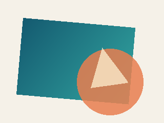
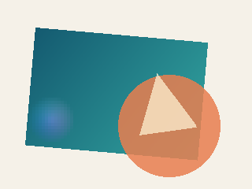

# 视觉验收规范

本规范回答接入方最常问的一个问题：**两次渲染是不是“同一张图”？**
结论是这个问题有三个不能互相替代的层级，必须分别取证、分别下结论。规范中的全部数字与图片都由
`scripts/visual_acceptance.py` 对真实 Atlas 进程实测产生，原始记录见
[`docs/assets/visual-acceptance/evidence.json`](assets/visual-acceptance/evidence.json)，
固定输入与变体见 [`examples/visual-acceptance/`](../examples/visual-acceptance)。

## 1. 三个层级不是同一个结论

| 层级 | 问题 | 判定对象 | Atlas 中的取证方式 | 能推出什么 | 不能推出什么 |
|---|---|---|---|---|---|
| L1 字节身份 | 两次下载是否为同一串 PNG 字节 | 原始 PNG 字节 | 比较字节或 SHA-256 摘要（`ETag` 即摘要） | 像素必然一致 | 换过编码方式仍可能像素一致但字节不同 |
| L2 解码像素一致 | 解码后的每个通道值是否相同 | 解码后的像素矩阵 | `POST /v1/compare`（仅服务端结果 ID） | 两张图在像素层面无差异 | 字节不一定相同；不代表渲染输入相同 |
| L3 肉眼可接受 | 差异是否在人眼可接受范围 | 像素差异 + 人工/外部判据 | 服务端只给差异指标，**不给通过结论** | 在接入方自定标准下可放行 | 不能回写成“像素一致”或“字节相同” |

关键纪律：**L1 成立可以推出 L2，L2 成立推不出 L1，L3 与前两者没有推导关系。**
“看着一样”只能回答 L3，不能用来回答 L1/L2；反过来，L2 报告里有任何一个非零指标，
严格像素准入就必须判不通过，哪怕肉眼几乎看不出差异。

### 1.1 当前接口实际提供的能力

- 结果下载 `GET /v1/artifacts/{id}` 返回 PNG 字节，响应头 `ETag` 是该字节的 SHA-256 摘要，
  支持 `If-None-Match` 做 304 重验。结果记录里的 `digest` 也是同一摘要。
- 像素比较 `POST /v1/compare`，请求体只有 `left`、`right` 两个**结果 ID**，
  返回 `changedPixels`、`maxDelta`、`meanDelta` 和尺寸；它解码两张结果图逐像素、逐通道比较，
  没有阈值参数，`changedPixels > 0` 即“有差异”，不存在“容差内通过”的返回值。
- 尺寸不同直接 `409 conflict`（`artifact dimensions differ`），不做缩放对齐。
- 比较只接受本服务存活的结果 ID，不能上传外部 PNG，也不能提交字节摘要做比较。

## 2. 固定输入与追溯链

所有案例派生自同一份固定输入
[`examples/visual-acceptance/fixed-input.json`](../examples/visual-acceptance/fixed-input.json)
（320×240，渐变矩形 + 半透明椭圆 + 裁剪组内多边形），它与 `examples/emblem.json` 是同一场景。
变体只改一个变量，每个变体文件都写明 `derivedFrom` 和具体改动：

- [`variant-recolor.json`](../examples/visual-acceptance/variant-recolor.json)：背景 `#F5F1E8 → #F0F1E8`；
- [`variant-nudge.json`](../examples/visual-acceptance/variant-nudge.json)：`plate` 图层 `transform.x 45 → 46`；
- [`variant-alpha.json`](../examples/visual-acceptance/variant-alpha.json)：叠加引用透明素材 `alpha-badge` 的位图图层及其 1 像素位移。

追溯链是：**固定输入（含 SHA-256）→ 快照 `snapshotDigest`（覆盖文档与素材闭包）→ 任务
（`snapshotId`、`scale`、`attempt`、幂等键）→ 结果 `artifactId` 与 PNG 摘要 → `/v1/compare` 指标**。
冻结后的渲染只读快照闭包，因此同一条链上的任何一次复核都能回到完全相同的输入。
重新生成全部证据：

```sh
python3 -I scripts/visual_acceptance.py
```

## 3. 严格像素准入 vs. 视觉容差（实测对比）

### 案例 A：字节身份成立时，三层全部通过

同一快照、同一 `scale`、同一幂等键重放，服务端返回**同一个任务和同一个结果**；
两次下载字节完全相同，自比 `/v1/compare` 三个差异指标全为 0。



| 指标 | 实测值 |
|---|---|
| 两次下载 SHA-256 | `8a3afec8…6e74`（两次相同） |
| 字节数 | 7060（两次相同） |
| `changedPixels / maxDelta / meanDelta` | 0 / 0 / 0 |
| 结论 | L1、L2、L3 同时成立 |

这是唯一可以理直气壮说“同一张图”的情形，适合作为回归基线的准入条件。

### 案例 B：只换压缩方式 —— 字节不同，像素一致

把案例 A 的 PNG 仅以不同 zlib 级别重新压缩（IHDR 等其余分块不动），
用 Go 标准库 `image/png` 独立解码确认三张图像素逐通道相同：

| 文件 | 字节数 | SHA-256（前 12 位） | 解码像素 |
|---|---|---|---|
| `case-a-render-1.png`（原始） | 7060 | `8a3afec879d3` | 基准 |
| `case-b-recompress-level9.png` | 3896 | `9a1efe178741` | 与基准完全相同 |
| `case-b-recompress-level1.png` | 8860 | `0b4a151b7119` | 与基准完全相同 |

- L1 **不成立**：摘要各不相同，字节身份被破坏；
- L2 **成立**：解码后像素矩阵一致；
- 注意 `/v1/compare` 无法为这组证据背书——它只接受服务端结果 ID，外部重压缩文件提交不进去。
  这类 L2 结论只能由接入方在自己的解码链上做出，并自行保存解码证据。

**准入含义**：若系统边界上存在任何重新编码/压缩环节，就不能把“摘要相等”当作像素回归的唯一闸门，
否则一次无害的压缩级别调整会被误判为渲染变更。

### 案例 C：细小几何与颜色变化 —— 指标非零，严格准入必须拦下

| 变化 | `changedPixels` | `maxDelta` | `meanDelta` | 肉眼观感 |
|---|---|---|---|---|
| 背景每通道约 5 的色差 | 43800 | 5 | 0.667 | 几乎看不出差别 |
| 矩形 1 像素水平位移 | 10200 | 225 | 0.398 | 边缘有细微错位 |


严格像素准入下两者都**不通过**（`changedPixels ≠ 0`），这是正确行为：
1 像素位移的 `maxDelta` 高达 225，因为边缘像素从一种颜色跳到另一种颜色，
平均值很低反而会掩盖这种结构性变化——所以容差判断不能只看 `meanDelta`。
是否“肉眼可接受”属于 L3，只能由接入方按自定标准人工复核，服务端不会、也不应替你给通过。

### 案例 D：透明素材 —— alpha 通道让容差更危险

`alpha-badge` 是 16×16 RGBA 素材，中心不透明、边缘按距离渐变到完全透明（四角 alpha=0）。
位图按最近邻采样，图层/组透明度再乘到 alpha 上，`/v1/compare` 对 R、G、B、**A** 四个通道逐通道求差。




| 比较 | `changedPixels` | `maxDelta` | `meanDelta` |
|---|---|---|---|
| 合成图 vs. 无素材基线 | 2752 | 57 | 0.395 |
| 素材位移 1 像素后互比 | 744 | 13 | 0.026 |

半透明边缘每个像素的差异都很小（位移后 `meanDelta` 仅 0.026），但它们真实改变了合成结果，
而且在不同背景上复合会放大成不同颜色。对透明素材建议：

1. **默认走严格 L2**，不要对带 alpha 的图层启用任何通道平均型容差；
2. 确需视觉容差时，alpha 通道单独设阈值且不与 RGB 混合平均，并保留差异区域的可视化人工复核；
3. 素材内容以素材摘要为准——相同 ID 不允许异内容替换，透明素材的任何字节变化都会进入快照闭包摘要。

### 案例 E：历史画面复核 —— 结果字节被清理后必须停止

对案例 A 的结果调用 `DELETE /v1/artifacts/{id}` 后实测：

- 再次下载返回 `410 gone`；对它调用 `/v1/compare` 同样返回 `410 gone`；
- 任务仍是 `succeeded`，`artifactId` 关联保留；结果记录保留 `digest`、`width`、`height`、`state=purged`。

清理后**仍然保留的证据**：任务事实（状态、快照、倍数、尝试次数）、结果 SHA-256 摘要与尺寸、
快照摘要与固定输入闭包、截断前的领域事件。**永久丢失的是 PNG 字节本体**，
无法再下载、解码或与任何新结果做像素比较。

因此历史复核的停止规则是：

1. 字节存活：可重新下载并用摘要验 L1、用 `/v1/compare` 验 L2；
2. 字节已清理（410）：**只能引用清理前已经留存的摘要和判定记录，不得新给出“像素通过”或“视觉通过”结论**；
   仅凭历史摘要相同，可以说“当时留存的字节身份未被推翻”，不能说“现在这张图仍然一致”——因为已经没有图可比；
3. 需要可重复的视觉验收，就必须在清理前把 PNG 与当次 `evidence` 归档到 Atlas 之外，
   服务端的清理动作不会替你保存复核材料。

## 4. 推荐的验收策略

1. **回归基线默认用 L1 + L2 双闸门**：同快照重渲染要求摘要相等（L1），
   跨修订比较要求 `changedPixels = 0`（L2）。任一不满足即判失败并保留两张 PNG 与 compare 响应。
2. **把 L3 显式做成独立流程**：由接入方在服务外用自己解码的图、自己定的阈值和人工复核记录支撑，
   结论单独标注“视觉可接受”，与 L1/L2 记录分开存档。
3. **几何/透明场景优先严格**：1 像素位移和半透明边缘的差异小但结构性强，
   容差应限定在纯色渐变、抗锯齿噪声等明确场景，并同时上报 `maxDelta` 与差异区域，不能只看平均值。
4. **历史复核先探活**：先 `GET /v1/artifacts/{id}`，410 即按第 3 节案例 E 的停止规则处理，
   不补造通过结论。
5. **归档三件套**：固定输入与变体 JSON、快照/结果摘要、PNG 实图与 compare 响应，
   一起存入外部系统，保证脱离 Atlas 状态后仍能复盘判定依据。

## 5. 容差是建议，不是现有接口能力（重要）

本规范出现的“视觉容差”“阈值”“人工复核放行”都是**对接入方验收流程的建议**，
当前 Atlas 接口并不具备这些能力：

- `POST /v1/compare` 没有 tolerance/threshold 参数，不返回 pass/fail，
  只有 `changedPixels`、`maxDelta`、`meanDelta` 三个原始指标；
- 服务端不接受外部图片、不做缩放对齐、不生成差异热图、不保存验收结论；
- 任何“容差内通过”的判定都发生在接入方系统里，其阈值、样本和复核记录由接入方负责，
  不得在文档或工单中表述为“Atlas 判定通过”。

若未来需要服务端容差能力，应作为新接口或新参数单独立项，并明确通道语义
（尤其是 alpha）、尺寸对齐规则和返回结构；在那之前，本规范的 L3 一律按外部能力描述。
